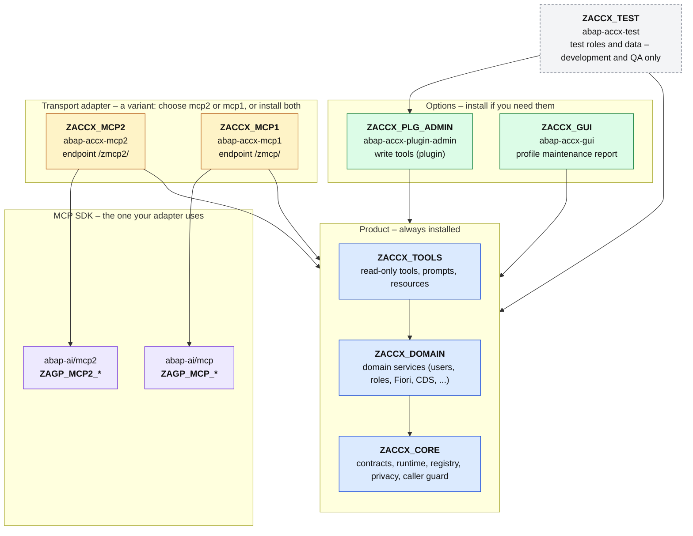

# ABAP Access Explorer (ACCX)

*[Deutsch](#deutsch) below.*

Access Explorer is an MCP server that runs **inside** an SAP ABAP system. It lets an AI
assistant answer the questions SAP Basis and authorization teams deal with every day:

- *Why does this user get "no authorization"?* What is missing, which role would close the
  gap, and how critical is that role?
- *Why is this Fiori app missing from the launchpad, or why does it fail to start?*
- *Where does this authorization come from?* Which role, composite role, reference user or profile.
- *Who may do X?* Critical authorizations, user hygiene, change history.
- *Which data do our OData services expose without protection?* What does a given user see
  in a CDS view?

ACCX reads the same sources as SUIM, PFCG, SU53, the Fiori launchpad and the CDS access
control runtime. It checks the authorizations of the **calling user** the way SUIM does. It
is read-only by default. Write tools for role maintenance and role assignment are in a
separate plugin and need a write profile, a stored plan and an explicit confirmation.

## Documentation

| | English | Deutsch |
|---|---|---|
| User guide (tools, scenarios, limits) | [docs/en/user-guide.md](docs/en/user-guide.md) | [docs/de/user-guide.md](docs/de/user-guide.md) |
| Overview (package structure, MCP flow, Copilot Studio example) | [docs/en/overview.md](docs/en/overview.md) | [docs/de/overview.md](docs/de/overview.md) |
| Architecture (layers, packages, security) | [docs/en/architecture.md](docs/en/architecture.md) | [docs/de/architecture.md](docs/de/architecture.md) |
| Change history | [CHANGELOG.md](CHANGELOG.md) | |

## Repositories

ACCX is split into abapGit repositories, one per ABAP package tree:

| Repository | ABAP package | Content | Required |
|---|---|---|---|
| [abap-accx-base](https://github.com/MDJoerg/abap-accx-base) (this one) | `ZACCX` (`ZACCX_CORE`, `ZACCX_DOMAIN`, `ZACCX_TOOLS`) | SDK-neutral core, domain services, read-only tools, documentation | yes |
| [abap-accx-mcp2](https://github.com/MDJoerg/abap-accx-mcp2) | `ZACCX_MCP2` | Adapter for the [abap-ai/mcp2](https://github.com/abap-ai/mcp2) MCP SDK | yes, to serve MCP (or mcp1) |
| [abap-accx-mcp1](https://github.com/MDJoerg/abap-accx-mcp1) | `ZACCX_MCP1` | Adapter for the older [abap-ai/mcp](https://github.com/abap-ai/mcp) MCP SDK | alternative to mcp2 |
| [abap-accx-plugin-admin](https://github.com/MDJoerg/abap-accx-plugin-admin) | `ZACCX_PLG_ADMIN` | Write tools: role maintenance and role assignment | optional |
| [abap-accx-gui](https://github.com/MDJoerg/abap-accx-gui) | `ZACCX_GUI` | Report to maintain the server profiles | optional |
| [abap-accx-test](https://github.com/MDJoerg/abap-accx-test) | `ZACCX_TEST` | Test roles and test data setup for integration tests | optional, not for production |

The core in `ZACCX` does not know any MCP SDK. Only the adapters `ZACCX_MCP2` and
`ZACCX_MCP1` depend on one, so the transport layer can be replaced without touching the tools.

## Package structure

Every box is an ABAP package and an abapGit repository of its own; an arrow means "depends
on". Blue is the product, yellow the **variants** (pick the adapter that matches your MCP
SDK, or install both), green the **options**, grey is for development only.

The flow of the MCP protocol between an AI client and ACCX, with Microsoft Copilot Studio as
an example client, is in the [overview](docs/en/overview.md#2-how-an-ai-client-talks-to-accx).

## Installation

Prerequisites: ABAP Platform 2023 (SAP_BASIS 758; older releases are not tested),
[abapGit](https://abapgit.org), and one MCP SDK: [abap-ai/mcp2](https://github.com/abap-ai/mcp2)
(these steps) or the older [abap-ai/mcp](https://github.com/abap-ai/mcp), which uses
**abap-accx-mcp1** instead of mcp2 (see its README).

1. Install the mcp2 SDK and follow its setup (ICF service for `/zmcp2/`).
2. Pull **abap-accx-base** into package `ZACCX` with abapGit. The folder logic is `PREFIX`.
3. Pull **abap-accx-mcp2** into package `ZACCX_MCP2`.
4. Run class `ZCL_ACCX_MCP2_SERVER` with F9 in ADT. It registers the read-only profile
   `bc/access-support` and every profile of table `ZACCX_PROFILE` (`<area>/<server>`, for
   example `bc/access-audit` with tool group AUDIT) in the mcp2 server table `ZMCP2_SERVERS`,
   and lists the visible tools per profile.
5. Optional, write tools: pull **abap-accx-plugin-admin** into `ZACCX_PLG_ADMIN`, run
   `ZCL_ACCX_ADMIN_PLUGIN` with F9 (activates plugin ADMIN and creates profile
   `bc/access-admin` with `ALLOW_WRITE`; refused in productive clients), then run
   `ZCL_ACCX_MCP2_SERVER` with F9 again.
6. Optional: schedule program `ZACCX_PLAN_CLEANUP` daily. It closes and deletes expired
   change plans.

Connect your MCP client to `https://<host>/zmcp2/bc/access-support?sap-client=<client>`
(ICF node `/zmcp2` with handler `ZCL_MCP2_HTTP_HANDLER`) with the user's own named account.
ACCX acts as that user and shows only what that user may display.

---

## Deutsch

Access Explorer ist ein MCP-Server, der **im** SAP-ABAP-System läuft. Ein KI-Assistent kann
damit typische Fragen von Basis- und Berechtigungsteams beantworten:

- Warum bekommt ein Benutzer „keine Berechtigung“, und welche Rolle würde die Lücke schließen?
- Warum fehlt eine Fiori-App im Launchpad?
- Woher stammt eine Berechtigung?
- Wer darf was? Dazu kritische Berechtigungen, Benutzerhygiene und Änderungshistorie.
- Welche Daten liefern OData-Services ungeschützt aus, und was sieht ein Benutzer in einer CDS-View?

ACCX prüft die Berechtigungen des aufrufenden Benutzers wie SUIM. Standardmäßig wird nur
gelesen. Schreibwerkzeuge liegen in einem eigenen Plugin und arbeiten nur mit Schreibprofil,
gespeichertem Plan und ausdrücklicher Bestätigung.

Dokumentation auf Deutsch: [Benutzerhandbuch](docs/de/user-guide.md),
[Architektur](docs/de/architecture.md) und [Überblick](docs/de/overview.md) mit der
Paketstruktur (welche Pakete Optionen oder Varianten sind), dem Ablauf des MCP-Protokolls
und einem Beispiel mit Microsoft Copilot Studio. Die Installationsschritte stehen oben unter
[Installation](#installation).

Die Repositories: `abap-accx-base` (dieses, Paket `ZACCX`), die Adapter-Varianten
`abap-accx-mcp2` und `abap-accx-mcp1`, die Optionen `abap-accx-plugin-admin` (Schreiben) und
`abap-accx-gui` (Profilpflege) sowie `abap-accx-test` (nur Entwicklung und QS). Die
Pakete und ihre Abhängigkeiten zeigt die Grafik unter [Package structure](#package-structure).
