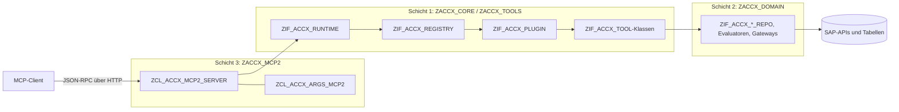
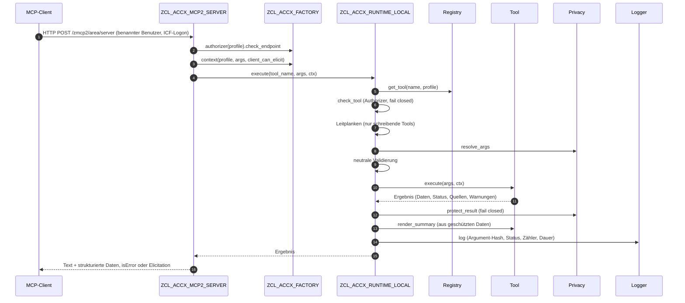

**Deutsch** | [English](../en/architecture.md)

# Access Explorer (ACCX) – Architektur

Access Explorer (ACCX) ist ein MCP-Server, der in einem SAP-ABAP-System läuft. Er beantwortet Fragen von SAP-Basis-Support, Berechtigungsadministration und Revision zu Benutzern, Rollen, Berechtigungen, Fiori Launchpad, OData-Services und CDS-Zugriffskontrolle. Das aktuelle Release steht in der Konstante `ZIF_ACCX_TYPES=>CO_RELEASE`.

Dieses Dokument beschreibt den Aufbau von ACCX. Tool-Referenz und Installationsschritte stehen in den READMEs der Repositories.

- Plattform: SAP_BASIS / SAP_UI (getestet auf ABAP Platform 2023), Fiori-Deployment embedded
- Sprachversion: Standard-ABAP (klassisch). ABAP Cloud wird **nicht** unterstützt
- MCP-Transport: SDK [abap-ai/mcp2](https://github.com/abap-ai/mcp2) über einen austauschbaren Adapter

---

## 1. Drei Schichten

| Schicht | Pakete | Inhalt | Kennt das MCP SDK? |
|---|---|---|---|
| 1 Tool-Katalog | `ZACCX_CORE`, `ZACCX_TOOLS` | Neutrale Verträge (Deskriptor, Argumente, Ergebnis), Runtime-Pipeline, Registry, eine Klasse pro Tool | nein |
| 2 Domänen-Services | `ZACCX_DOMAIN` | Reader und Evaluatoren für Benutzer, Rollen, Berechtigungen, SUIM, Launchpad-Inhalte, OData, CDS/DCL, Änderungsbelege. Alle SAP-APIs und Tabellenzugriffe sind hier gekapselt | nein |
| 3 SDK-Adapter | `ZACCX_MCP2` | Übersetzt Deskriptoren in MCP-Tooldefinitionen, Requests in `ZIF_ACCX_ARGS` und Ergebnisse in MCP-Antworten | **ja, als einzige Schicht** |

### Warum das SDK austauschbar bleibt

- Tools sehen nie ein SDK-Objekt. Sie bekommen `ZIF_ACCX_ARGS` und `ZIF_ACCX_CONTEXT` und liefern die neutrale Struktur `ZIF_ACCX_TYPES=>TY_RESULT`.
- Ein Tool beschreibt sich über einen neutralen Deskriptor (`TY_TOOL_DESCRIPTOR`: Name, Titel, Beschreibung, Gruppe, typisierte Parameter, Kennzeichen read-only/idempotent/destructive, Sensitivität, Plugin). Der Adapter erzeugt daraus JSON-Schema und MCP-Annotationen.
- Die Parameterprüfung (Pflichtfelder, Enumerationen, Bereiche, Längen) läuft in der Core-Runtime und nicht nur im SDK. Jeder Transportweg bekommt damit dieselben Prüfungen.
- Der Adapter enthält kein `CASE` über Tool-Namen. Ein neues Tool ist eine neue Klasse, die ein Plugin registriert; der Adapter bleibt unverändert.
- Adapter beziehen alles über `ZCL_ACCX_FACTORY` und rufen nur das Interface `ZIF_ACCX_RUNTIME` auf.

Ein anderer Transportweg (ein anderes ABAP-MCP-SDK, ein REST/JSON-Handler, eine RFC-Fassade) ist ein neues Adapterpaket daneben, mit einer Serverklasse und einer Implementierung von `ZIF_ACCX_ARGS`. Core, Tools und Plugins bleiben unverändert.

---

## 2. Pakete und Repositories

Ein abapGit-Repository ist eine Installationseinheit. Was unabhängig installiert, ersetzt oder weggelassen werden kann, hat ein eigenes Hauptpaket und ein eigenes Repository.

| Repository | Hauptpaket | Unterpakete | Inhalt | Abhängig von | Installation |
|---|---|---|---|---|---|
| [abap-accx-base](https://github.com/MDJoerg/abap-accx-base) | `ZACCX` | `ZACCX_CORE`, `ZACCX_DOMAIN`, `ZACCX_TOOLS` | Produkt: Verträge, Runtime, Registry, Privacy, Caller-Guard, Domänen-Services, lesende Tools, Konfigurationstabellen | SAP_BASIS, SAP_UI | immer |
| [abap-accx-mcp2](https://github.com/MDJoerg/abap-accx-mcp2) | `ZACCX_MCP2` | – | MCP-Adapter für das mcp2 SDK | `ZACCX`, mcp2 SDK (`ZAGP_MCP2_*`) | wenn mcp2 der Transportweg ist |
| [abap-accx-plugin-admin](https://github.com/MDJoerg/abap-accx-plugin-admin) | `ZACCX_PLG_ADMIN` | – | Plugin ADMIN: schreibende Tools für Rollenpflege und Rollenzuordnung | `ZACCX` | optional |
| [abap-accx-test](https://github.com/MDJoerg/abap-accx-test) | `ZACCX_TEST` | – | Testdaten-Setup (Testrollen, SUIM-Testregeln) | `ZACCX`, `ZACCX_PLG_ADMIN` | nur Entwicklung / QS |

**Installationsreihenfolge:** mcp2 SDK → `abap-accx-base` → `abap-accx-mcp2` → Plugins (`abap-accx-plugin-admin`) → `abap-accx-test`.

Regeln:

- Adapter, Plugins und Testpaket sind **keine** Unterpakete von `ZACCX`, obwohl ihre Namen mit `ZACCX_` beginnen; sonst würde abapGit sie in das Produkt-Repository ziehen.
- Alle Pakete gehören zu einer Softwarekomponente außer `ZLOCAL` (z. B. `HOME`), weil `ZLOCAL` auf neueren Releases ABAP Cloud erzwingt und das mcp2 SDK dann nicht nutzbar ist.
- Nur `ZACCX_MCP2` verwendet das mcp2 SDK. Plugins nutzen nur die öffentlichen Core-Verträge und funktionieren damit mit jedem Adapter.
- abapGit kennt keine Abhängigkeitsauflösung; die Abhängigkeiten sind in jedem Repository dokumentiert.

---

## 3. Core-Verträge

Alle Verträge liegen in `ZACCX_CORE` und sind frei von SDK-Typen.

| Vertrag | Implementierung(en) | Rolle |
|---|---|---|
| `ZIF_ACCX_TYPES` | – | Neutrale Typen und Konstanten: Ergebnisstatus (`ok`, `partial`, `not_found`, `ambiguous`, `denied`, `invalid`, `error`, `confirmation_required`), Parameterarten, Tool-Gruppen (USER, ROLE, DIAG, FIORI, DATA, AUDIT, ADMIN), reservierte Parameter (`max_rows`, `cursor`, `language`, `system`, `plan_id`, `confirm`), Tool-Deskriptor, Ergebnis, Release |
| `ZIF_ACCX_TOOL` | `ZCL_ACCX_TOOL_BASE` (optionale abstrakte Basis), `ZCL_ACCX_T_*` | Ein Tool. Zwei Phasen: `execute` erzeugt Daten, Status, Quellen und Warnungen; `render_summary` schreibt danach die Markdown-Zusammenfassung aus den bereits geschützten Daten. `get_descriptor` beschreibt das Tool |
| `ZIF_ACCX_ARGS` | `ZCL_ACCX_ARGS_MAP` (im Speicher), `ZCL_ACCX_ARGS_MCP2` (Adapter) | Adapterneutraler Zugriff auf Tool-Argumente (`has`, `get_string`, `get_integer`, `get_boolean`, `get_strings`, `get_names`) |
| `ZIF_ACCX_CONTEXT` | `ZCL_ACCX_CONTEXT` | Request-Kontext: Aufrufer, Sprache, Zeilenlimit, Serverprofil, System-ID, Caller-Guard, Privacy-Strategie, Authorizer, ob der Client Elicitation kann, und warum schreibende Tools nicht laufen dürfen (`write_problem`) |
| `ZIF_ACCX_REGISTRY` | `ZCL_ACCX_REGISTRY` | Findet Plugins, sammelt ihre Tools, filtert sie nach den Tool-Gruppen des Profils, lehnt doppelte Namen ab, meldet Plugin-Probleme |
| `ZIF_ACCX_RUNTIME` | `ZCL_ACCX_RUNTIME_LOCAL` | Einziger Einstieg für Adapter: `get_catalog` (sichtbare Tools) und `execute` (Pipeline, siehe Abschnitt 4). Wirft nie eine Ausnahme; jeder Fehler ist ein Ergebnis mit Status |
| `ZIF_ACCX_PLUGIN` | `ZCL_ACCX_CORE_PLUGIN` (ID CORE), `ZCL_ACCX_ADMIN_PLUGIN` (ID ADMIN) | Plugin-Vertrag: `get_info` (ID, Titel, Version, benötigte Core-API), `check_prerequisites`, `get_tools` |
| `ZIF_ACCX_LOGGER` | `ZCL_ACCX_LOGGER_DB` | Audit-Log jedes Tool-Aufrufs in `ZACCX_LOG` |
| `ZIF_ACCX_PRIVACY` | `ZCL_ACCX_PRIVACY_NONE`, `ZCL_ACCX_PRIVACY_WITHHOLD` | Datenschutz-Strategie: `protect_result` (ausgehende Daten), `resolve_args` (eingehende Pseudonyme) |
| `ZIF_ACCX_AUTHORIZER` | `ZCL_ACCX_AUTHORIZER` (erlaubt), `ZCL_ACCX_AUTHORIZER_DENY` (verweigert) | Erweiterungspunkt Nutzungsberechtigung: `check_endpoint`, `check_tool` |
| `ZIF_ACCX_CALLER_GUARD` | `ZCL_ACCX_CALLER_GUARD` | Datenbezogene Anzeigeprüfungen des Aufrufers (Benutzer, Benutzergruppen, Rollen, Profile, Berechtigungen, Änderungsbelege, privilegierte CDS-Datenvorschau), pro Request gepuffert |
| `ZIF_ACCX_PLAN_STORE` | `ZCL_ACCX_PLAN_STORE` | Pläne schreibender Tools in `ZACCX_PLAN`: `create`, `get`, `claim` (einmalig), `close`, `cleanup` |
| – | `ZCL_ACCX_FACTORY` | Erzeugt alle Core-Bausteine aus der Profilkonfiguration; Test-Seam (`inject`, `reset`) |
| – | `ZCX_ACCX_ERROR` | Ausnahme mit Ergebnisstatus und einer für das LLM lesbaren Meldung |

Domänen-Services werden über `ZCL_ACCX_DOMAIN_FACTORY` bezogen, die denselben Test-Seam `inject`/`reset` hat.

---

## 4. Ablauf eines `tools/call`

Pipeline von `ZCL_ACCX_RUNTIME_LOCAL->execute`:

1. Tool in der Registry für das Serverprofil auflösen; unbekanntes Tool: `invalid`.
2. Nutzungsberechtigung `ZIF_ACCX_AUTHORIZER->check_tool`; eine Ausnahme zählt als nicht berechtigt: `denied`.
3. Nur schreibende Tools (Deskriptor `read_only = false`): Das Profil muss Schreiben erlauben und der Mandant darf kein Produktivmandant sein, sonst `denied`; `plan_id` und `confirm` nur gemeinsam, sonst `invalid`.
4. Pseudonyme in den Argumenten auflösen (`resolve_args`).
5. Neutrale Prüfung der Parameter gegen den Deskriptor; `invalid` mit lesbarer Meldung.
6. Tool ausführen. `ZCX_ACCX_ERROR` behält seinen Status; jede andere Ausnahme wird zu `error`.
7. `protect_result`. Schlägt es fehl, werden die Daten zurückgehalten.
8. `render_summary` aus den geschützten Daten, damit keine personenbezogenen Daten über den Text durchrutschen.
9. Audit-Log schreiben: Argumente nur als SHA-256-Hash; bei schreibenden Tools das Ergebnis (Plan-ID und Zusammenfassung), auch bei `ok`. Ein Fehler beim Protokollieren bricht den Aufruf nie ab.

`tools/list` nutzt `get_catalog`: die Tools des Profils, ohne schreibende Tools, wo Schreiben nicht erlaubt ist, und ohne Tools, die der Authorizer ablehnt.

Der Adapter bildet das Ergebnis ab: `ok`/`partial` werden zu Text (Zusammenfassung, Warnungen, nächste Schritte, Quellen) plus strukturierten Daten; `denied`/`invalid`/`error` werden zu einem Tool-Ergebnis mit `isError`; `confirmation_required` wird zu einer Formular-Elicitation, wenn der Client sie unterstützt, sonst zum Plan als Text.

---

## 5. Plugins

Der Core läuft auf jedem nackten ABAP-Stack. Lösungsspezifische oder riskante Funktionen kommen als eigenes Paket mit einer Klasse, die `ZIF_ACCX_PLUGIN` implementiert.

- **Erkennung:** Die Registry findet alle Klassen, die `ZIF_ACCX_PLUGIN` implementieren.
- **Aktivierung ist eine bewusste Handlung:** Das eingebaute Plugin CORE (`ZCL_ACCX_CORE_PLUGIN`, alle lesenden Tools) ist immer aktiv. Jedes andere Plugin ist inaktiv, bis es eine aktive Zeile in `ZACCX_PLUGIN` hat, optional auf bestimmte Profile beschränkt und mit Priorität.
- **Kompatibilität:** Ein Plugin, dessen `required_core_api` von `ZIF_ACCX_PLUGIN=>CO_CORE_API_VERSION` abweicht, wird übersprungen. Die Core-API-Version steigt nur bei inkompatiblen Vertragsänderungen.
- **Isolation:** Ein Plugin, das eine Ausnahme wirft oder `check_prerequisites` nicht besteht, wird übersprungen und über `ZIF_ACCX_REGISTRY->get_issues` gemeldet; die Tool-Liste bricht nie wegen eines Plugins ab.
- **Konflikte:** Tool-Namen sind global eindeutig; CORE wird zuerst geladen, bei einem doppelten Namen gewinnt also der Core und das Plugin-Tool wird ignoriert.
- **Deinstallation:** Wird das Paket entfernt, fehlt die Klasse, und die veraltete Zeile in `ZACCX_PLUGIN` bleibt wirkungslos.

### Plugin ADMIN und die Schreib-Leitplanken

`ZACCX_PLG_ADMIN` liefert die einzigen schreibenden Tools: `apply_role_change` (PFCG-Rolle ändern oder anlegen, Sammelrollen pflegen, Änderungen an abgeleitete Rollen weitergeben) und `assign_role` (Rolle zuordnen, Gültigkeit einer direkten Zuordnung ändern, Zuordnung entfernen). Ein Start von `ZCL_ACCX_ADMIN_PLUGIN` mit F9 in ADT aktiviert das Plugin für das Profil `bc/access-admin` und legt dieses Profil mit Schreiberlaubnis an; in einem Produktivmandanten verweigert es das.

| Leitplanke | Wo | Wirkung |
|---|---|---|
| Schreibprofil | Core-Runtime, `ZACCX_PROFILE-ALLOW_WRITE` | Schreibende Tools werden nur in Profilen mit Schreiberlaubnis angeboten und ausgeführt; sonst sind sie ausgeblendet und ein Aufruf liefert `denied` |
| Produktivmandant | Core-Runtime, `T000-CCCATEGORY` | Nie in einem Produktivmandanten, unabhängig vom Profil |
| Nutzungsberechtigung | `ZIF_ACCX_AUTHORIZER` | Gilt für schreibende Tools wie für jedes Tool (z. B. eine Kundenprüfung auf die Tool-Gruppe ADMIN) |
| Plan und Bestätigung | Tool, Plan-Store, Adapter | Der erste Aufruf plant nur: Er speichert den Plan in `ZACCX_PLAN` (15 Minuten gültig) und liefert `confirmation_required`. Erst ein zweiter Aufruf mit `plan_id` und `confirm = true` führt aus. Der Core lehnt `plan_id` ohne `confirm` und umgekehrt ab |
| Einmalige Ausführung durch den Ersteller | `ZIF_ACCX_PLAN_STORE->claim` | Ein Plan wird mit einem einzigen bedingten Update beansprucht: nur durch seinen Ersteller, nur für dasselbe Tool, nur vor Ablauf, nur einmal |
| Fingerprint | Tool | Der Plan speichert einen Fingerprint des Zielzustands (Menü, Berechtigungsdaten, Profil, Einzel- und abgeleitete Rollen; bei Zuordnungen die Zuordnungen und Profile des Benutzers). Hat sich das Ziel zwischen Plan und Ausführung geändert, wird die Ausführung abgelehnt und der Plan storniert |
| Prüfung kritischer Berechtigungen | Tool, `ZIF_ACCX_CRITICAL_RULES` | Bevor ein Plan gespeichert wird, werden die in SUIM gepflegten kritischen Berechtigungen und Kombinationen ausgewertet. Jeder Zugewinn wird abgelehnt, solange der Aufrufer nicht `accept_critical` setzt |
| Weitere Ablehnungen | Tool | Eigene Rollenzuordnungen, SAP-Vorlagerollen (stattdessen kopieren), abgeleitete Rollen (Referenzrolle ändern), fehlende Änderungsberechtigung (`S_USER_AGR`, `S_USER_GRP`) |
| MCP-Bestätigung | Adapter | Schreibende Tools tragen `destructiveHint`. Clients mit Formular-Elicitation werden direkt gefragt; Ablehnen storniert den Plan. Andere Clients bekommen den Plan als Text, und die Server-Instructions verlangen die ausdrückliche Freigabe durch den Benutzer |
| Nachvollziehbarkeit | Logger, SAP-Änderungsbelege | Jeder schreibende Aufruf wird mit Ergebnis protokolliert; SAP schreibt zusätzlich eigene Änderungsbelege |

---

## 6. Sicherheitsmodell

- **Nur benannte Benutzer.** Der Aufrufer ist der Prinzipal (`sy-uname`). Ein technischer Superuser als MCP-Aufrufer ist nicht vorgesehen; Ergebnisse spiegeln die Berechtigungen des Aufrufers wider, wie in SUIM.
- **Endpunkt:** ICF-Logon und `S_ICF` auf dem Serviceknoten, danach `ZIF_ACCX_AUTHORIZER->check_endpoint`.
- **Tool-Ebene:** `ZIF_ACCX_AUTHORIZER->check_tool` mit dem vollständigen Deskriptor (Gruppe, Sensitivität, Plugin). Die Prüfung filtert den Katalog und wird vor jeder Ausführung erneut durchlaufen.
- **Datenebene – Caller-Guard:** Die meisten SAP-Lese-APIs und -Tabellen prüfen den Aufrufer nicht. Tools filtern deshalb jede Zeile über `ZIF_ACCX_CALLER_GUARD`:
  - Benutzer und Benutzergruppen: `S_USER_GRP` Aktivität 03 (Änderungsbelege: 08)
  - Rollen: `S_USER_AGR` Aktivität 03 (Änderungsbelege: 08)
  - Profile: `S_USER_PRO` 03; Berechtigungen: `S_USER_AUT` 03
  - Zeilenzahlen von CDS-Entitäten ohne Zugriffskontrolle (`simulate_cds_access`): Prüfung der ADT-Datenvorschau mit DCL-Übersteuerung (`S_DEVELOP`)
  - Zeilen, die der Aufrufer nicht anzeigen darf, werden entfernt und gezählt (`hidden_by_authorization`), nie stillschweigend unterschlagen. Die SUIM-APIs und der SU53-Reader prüfen den Aufrufer selbst.
- **Kein eigenes Berechtigungsobjekt.** ACCX liefert bewusst keines aus. Die Nutzungsberechtigung wird im Kundenprojekt entschieden:
  1. Berechtigungsobjekt im Kundennamensraum anlegen (z. B. mit Feldern für Profil, Tool-Gruppe und Aktivität).
  2. Von `ZCL_ACCX_AUTHORIZER` erben und `check_endpoint` und/oder `check_tool` mit einem `AUTHORITY-CHECK` auf dieses Objekt redefinieren.
  3. Die Klasse in `ZACCX_PROFILE-AUTHORIZER_CLASS` eintragen.
  Ohne Konfiguration erlaubt `ZCL_ACCX_AUTHORIZER` die Nutzung. Lässt sich die konfigurierte Klasse nicht instanziieren, verweigert `ZCL_ACCX_AUTHORIZER_DENY` alles; wirft die Kundenmethode eine Ausnahme, gilt das Tool als nicht berechtigt.
- **Fail closed** bei Nutzungsberechtigung, Datenschutz und Schreib-Leitplanken.
- **Nebenwirkung:** Simulierte Prüfungen (`AUTHORITY-CHECK ... FOR USER`), die fehlschlagen, landen im SU53-Puffer des aufrufenden Benutzers. Die Tools warnen davor, und der Reader für Fehlschläge filtert solche Einträge heraus.

---

## 7. Privacy-Schicht

Datenschutz wird zentral in der Runtime angewendet, nicht in jedem Tool.

- `ZIF_ACCX_PRIVACY->protect_result` läuft nach `execute` und **vor** `render_summary`. Die Markdown-Zusammenfassung entsteht damit nur aus geschützten Daten.
- `ZIF_ACCX_PRIVACY->resolve_args` läuft vor der Validierung; es soll Pseudonyme auf Klarwerte zurückführen, sodass Tools nur Klarwerte sehen.
- Konfiguration pro Profil in `ZACCX_PROFILE`: `PRIVACY_MODE` (`NONE`, `PSEUDONYMIZE`, `MINIMIZE`) oder eine Kundenklasse in `PRIVACY_CLASS`, die `ZIF_ACCX_PRIVACY` implementiert.
- Umgesetzt: `NONE` (`ZCL_ACCX_PRIVACY_NONE`). Jeder andere Modus, eine nicht nutzbare Klasse oder eine Ausnahme in `protect_result` führt zu `ZCL_ACCX_PRIVACY_WITHHOLD` bzw. einem gleichwertigen Fehlerergebnis: Daten, strukturierte Daten und Zusammenfassung werden mit einer Warnung zurückgehalten.
- Die Modi `PSEUDONYMIZE` und `MINIMIZE` sind reserviert und noch nicht umgesetzt.
- Das Audit-Log speichert nie Argumentwerte, nur deren SHA-256-Hash.

---

## 8. Konfiguration und Bereinigung

| Tabelle | Auslieferungsklasse | Zweck |
|---|---|---|
| `ZACCX_PROFILE` | C | Eine Zeile pro Serverprofil (`<area>/<server>`, z. B. `bc/access-support`): `TOOL_GROUPS` (Kommaliste oder `*`), `PRIVACY_MODE`, `PRIVACY_CLASS`, `AUTHORIZER_CLASS`, `MAX_ROWS`, `ALLOW_WRITE`. Ein Profil ohne Zeile bietet alle Tools der aktiven Plugins mit Standardeinstellungen und ohne schreibende Tools an |
| `ZACCX_PLUGIN` | A | Plugin-Aktivierung: `PLUGIN_ID`, `CLASS_NAME`, `ACTIVE`, `PRIORITY`, `PROFILES`, aktiviert von/am |
| `ZACCX_LOG` | A | Audit-Log: Zeit, Aufrufer, Profil, System-ID, Tool, Status, Zeilen- und ausgeblendete Zähler, Dauer, Argument-Hash, Meldung |
| `ZACCX_PLAN` | A | Pläne schreibender Tools: ID, Tool, Aufrufer, Profil, Ziel, Zustand, angelegt/läuft ab/geschlossen, Fingerprint, Payload (JSON), Plantext, Ergebnis |

Zeilenlimit: Standard 50, Maximum 500; pro Profil `MAX_ROWS`, pro Aufruf der reservierte Parameter `max_rows`.

Das Serverprofil ist der Teil `<area>/<server>` des mcp2-Endpunkts. Ein Start von `ZCL_ACCX_MCP2_SERVER` mit F9 registriert das Standardprofil und jedes Profil aus `ZACCX_PROFILE` als mcp2-Endpunkt und listet die sichtbaren Tools pro Profil sowie Plugin-Probleme. Mehrere Profile zeigen auf dieselbe Adapterklasse.

Kritische Berechtigungen, Kombinationen und ihre Varianten werden in SUIM gepflegt, nicht in ACCX.

### Bereinigungsprogramm `ZACCX_PLAN_CLEANUP`

Vom Administrator als periodischer Hintergrundjob einzuplanen (z. B. täglich). Es ruft `ZIF_ACCX_PLAN_STORE->cleanup` auf:

- abgelaufene Pläne im Zustand `OPEN` werden `CANCELLED`;
- Pläne, die eine bestimmte Anzahl Minuten nach Ablauf (Standard 60) noch `RUNNING` sind – eine durch einen Laufzeitfehler abgebrochene Ausführung –, werden `FAILED` mit dem Hinweis, dass die Änderung unvollständig sein kann;
- geschlossene Pläne werden nach einer Aufbewahrungsfrist gelöscht (Standard 90 Tage, 0 = behalten).

Jede Zeile wird nur in dem Zustand geändert, in dem sie gelesen wurde; die Bereinigung kommt einem gleichzeitigen Claim daher nicht in die Quere. Ein Testlauf ändert nichts. Ergebnisse gehen in die Liste und das Joblog. `ZACCX_LOG` bleibt unberührt.

Planzustände: `OPEN`, `RUNNING`, `EXECUTED`, `PARTIAL`, `FAILED`, `CANCELLED`.

---

## 9. Tests

- **ABAP Unit** in jeder Tool-Klasse und in den zentralen Core- und Domänenklassen, alle mit `RISK LEVEL HARMLESS`, `DURATION SHORT`.
- **Test-Doubles** ersetzen Bausteine über die Test-Seams `ZCL_ACCX_FACTORY=>inject` (Registry, Runtime, Privacy, Authorizer, Caller-Guard, Plan-Store) und `ZCL_ACCX_DOMAIN_FACTORY=>inject` (Domänen-Services); `reset` stellt die Standards wieder her. Argumente entstehen mit `ZCL_ACCX_ARGS_MAP`; ein MCP SDK wird nicht gebraucht.
- **Runtime-Tests** (`ZCL_ACCX_RUNTIME_LOCAL`) decken Validierung, Fehlerabbildung, Zeilenlimit, Privacy vor Zusammenfassung, Privacy-Fehler, Protokollierung, Authorizer verweigert/filtert/stürzt ab sowie die Schreib-Leitplanken ab (ohne Erlaubnis ausgeblendet, erst Plan dann Bestätigung, Kombinationen von `plan_id`/`confirm`, Protokollierung schreibender Aufrufe).
- **Datenbankzugriffe** des Plan-Stores werden mit dem ABAP-SQL-Test-Double-Framework (`CL_OSQL_TEST_ENVIRONMENT`) getestet.
- **Integrationstests** des Plugins CORE laufen gegen das echte System.
- **Ende-zu-Ende** über HTTP mit einem Administrator und einem eingeschränkten Support-Benutzer, um den Caller-Guard zu prüfen.
- **Testdatenpaket `ZACCX_TEST`** (nur Entwicklung und QS, nie produktiv): `ZCL_ACCX_TEST_SETUP` hält den Sollzustand der Testrollen `ZACCX_T_*` und der SUIM-Testregeln (kritische Berechtigung, kritische Kombination, Varianten). Standardmäßig meldet es nur Abweichungen; Anwenden ist ein ausdrücklicher Schalter und wird in Produktivmandanten abgelehnt. Es nutzt den deklarativen Rollen-Writer `ZIF_ACCX_ROLE_WRITER` aus `ZACCX_PLG_ADMIN`. `ZCL_ACCX_TEST_WRITE_ROLE` setzt die Zielrollen der Tests schreibender Tools zurück. Testbenutzer werden manuell angelegt.

---

## 10. SAP-Quellen pro Domänen-Service

Stabilitätsklassen:

- **A** – freigegebene oder stabile API (BAPI, RFC-fähige SUIM-API, Kernel-Anweisung)
- **B** – stabile, aber nicht freigegebene DDIC-Tabellen oder nicht freigegebene Klassen, nur lesend
- **C** – interne Logik oder Workaround, in genau einer Klasse gekapselt, damit ein Release-Wechsel nur eine Stelle betrifft

| Domänen-Service | Verantwortung | SAP-Quellen | Klasse |
|---|---|---|---|
| `ZIF_ACCX_USER_REPO` | Benutzerstamm, Benutzergruppen, Rollen- und Profilzuordnungen, Profilparameter | `USR02`, `USR21`/`ADRP`, `USR11`, `AGR_USERS`, `UST04`, `AGR_1016` | B |
| `ZIF_ACCX_ROLE_REPO` | Rollenkopf, Typ, Ableitung, Sammelrollen, Menü, Berechtigungen mit PFCG-Status, Organisationsebenen, Profilstatus, Inhaber | `AGR_DEFINE`, `AGR_1250`, `AGR_1251`, `AGR_1252`, `AGR_1016`, `AGR_AGRS`, `AGR_FLAGS`, `AGR_TEXTS`, `AGR_TCODES`, `AGR_USERS`, `USORG` | B |
| `ZIF_ACCX_AUTH_EVALUATOR` | Erforderliche Prüfungen einer Transaktion, Simulation für einen anderen Benutzer | `AUTHORITY-CHECK ... FOR USER` (A); `TSTC`, `TSTCA`, `TOBJ` (B) | A / B |
| `ZIF_ACCX_ACCESS_ORIGIN` | Herkunft von Berechtigungen im Benutzerstamm (Rolle, Sammelrolle, Profil, Referenzbenutzer) | `UST04`, `USREFUS`, `UST10C`, `UST10S`, `UST12`, `AGR_1016`, `AGR_AGRS` | B |
| `ZIF_ACCX_SUIM_GATEWAY` | Benutzer und Rollen nach Kriterien, kritische Zugriffe pro SUIM-Variante; immer `DESTINATION 'NONE'` (eigene Session, geschützt vor `LEAVE PROGRAM` und Reportzustand) | `SUSR_SUIM_API_RSUSR002`, `SUSR_SUIM_API_RSUSR070`, `SUSR_SUIM_API_RSUSR008_009_NEW`, `SUSR_API_RSUSR008_009_NEW_ROLE` (prüfen den Aufrufer); `USRVAR*` | A (intern reportbasiert) |
| `ZIF_ACCX_CRITICAL_RULES` | Kritische Berechtigungen und Kombinationen mit SUIM-Semantik | `USCRAUTHID`, `USCRAUTH`, `USCRAUIDT`, `USRCOMB`, `USCRCOMID` | B |
| `ZIF_ACCX_FAILURE_SOURCE` | Fehlgeschlagene Prüfungen eines Benutzers (SU53 aller Applikationsserver, Benutzer-Trace), Trace-Status | `SUSR_USER_SU53_READ` (prüft den Aufrufer), `SUAUTH_READ_USER_TRACE`, `CL_SUSR_TOOLS_KERNEL`, `SUAUTHVALFILTER` | B |
| `ZIF_ACCX_PROPOSAL_SOURCE` | SU24-Vorschlagswerte von Transaktionen und Service-Hashes | `USOBX_C`, `USOBT_C` | B |
| `ZIF_ACCX_FIORI_REPO` | Kataloge, Kacheln, Target Mappings, Gruppen, Spaces, Pages, Launchpad-Einstellungen, Berechtigungsvorschläge von Katalogen, OData-Services, ICF | Öffentliche FDM-Katalog- und Gruppen-API (Paketschnittstelle `/UI2/FDM_PUBLIC_API_EXT`) (A); FDM-Space- und Page-API, `/UI2/CL_FLP_SETTINGS_API`, UI5 App Index, `AGR_HIER`/`AGR_BUFFI`, `/IWFND/I_MED_SRH`, `/IWFND/C_MGDEAM`, `ICFSERVICE`, `USOBHASH` (B); `/UI2/CL_CATALOG_DETAIL` (PFCG-Katalogdetails) (B/C) | A / B / C |
| `ZIF_ACCX_CDS_ACCESS` | CDS-Entitäten, Annotation zur Zugriffskontrolle, DCL-Rollen, exponierende Service-Definitionen und -Bindings | `DDLDEPENDENCY`, `DD02B`, `DDHEADANNO`, `DDDDLSRCT`, `TADIR`, `ACMDCLMETADATA`, `ACMDCLSRC`, `SRVD_RT_ENTITIES`, `SRVB_SERVICES`, `/IWFND/I_MED_SRH`, `/IWFND/C_V4_MSGR` (B); DCL-Quelltext als Text analysiert (`ZCL_ACCX_DCL_ANALYZER`) (C); Zugriffsbeschränkungen für einen Benutzer aus der ACM-Laufzeit `CL_ACMRT_KERNEL_PROXY` (`IF_ACMRT_RUNTIME~GET_ACCESS_RESTRICTIONS`, wie SACMSEL) (B); Zeilenzahlen mit `SELECT COUNT(*) ... WITH PRIVILEGED ACCESS` (A) | B / C |
| `ZIF_ACCX_CHANGE_REPO` | Änderungsbelege zu Rollen und Benutzern | `CDHDR`, `CDPOS` (Objekte PFCG, IDENTITY), `USH02` | B |
| `ZIF_ACCX_ROLE_CHANGER` (Plugin ADMIN) | Inkrementelle Rollenänderung, Sammelrollen, abgeleitete Rollen, Generierung | `CL_PFCG_MENU_MODIFY`, `PRGN_AUTO_GENERATE_PROFILE_NEW`, `PRGN_RFC_*`, `PRGN_COPY_AGR`, `SUPRN_TRANSFER_AUTH_DATA` (B); Werte für offene Felder direkt in `AGR_1251` mit Änderungsbelegen (C) | B / C |
| `ZIF_ACCX_ASSIGNMENT_WRITER` (Plugin ADMIN) | Direkte Rollenzuordnungen eines Benutzers | `BAPI_USER_GET_DETAIL`, `BAPI_USER_ACTGROUPS_ASSIGN` (prüfen den Aufrufer, schreiben Änderungsbelege) | A |

Domänen-Services lesen **ohne** Berechtigungsprüfung, sofern die SAP-API nicht selbst prüft; die Tools filtern mit dem Caller-Guard. Die Implementierungsklassen der Domäne sind nicht final, Kundenprojekte können also von ihnen erben (z. B. um kritische Regeln aus einem anderen Regelwerk zu lesen).

---

## 11. Ausblick Mehrsystembetrieb (nicht umgesetzt)

Standard ist eine ACCX-Instanz pro System; ein MCP-Client bindet mehrere Server ein. Ein zentraler Server, der mehrere Systeme föderiert, ist **nicht umgesetzt**. Der Entwurf hält ihn ohne Änderung am Adapter möglich: Adapter kennen nur `ZIF_ACCX_RUNTIME`, Ergebnis und Deskriptor haben reservierte JSON-Felder (`data_json`, `output_schema_json`), der Parametername `system` ist reserviert, und `ZACCX_LOG` hat eine Spalte für die System-ID.
