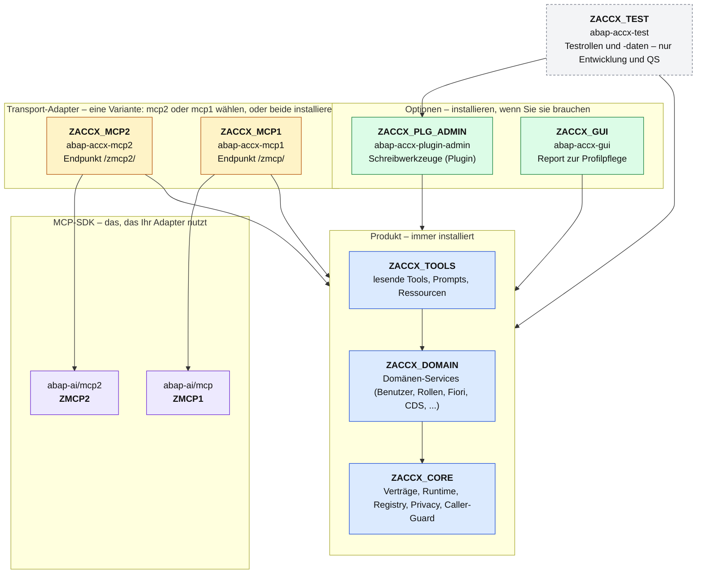
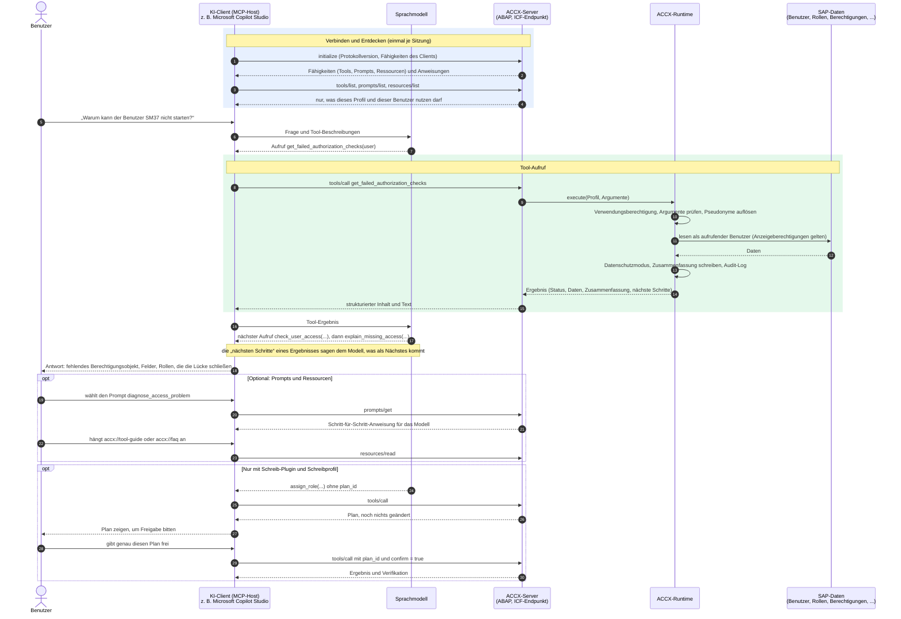
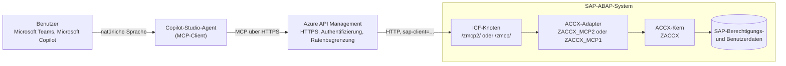

# Access Explorer (ACCX) – Überblick: Pakete und MCP-Ablauf

*[English](../en/overview.md)*

Diese Seite zeigt zweierlei: wie die ABAP-Pakete von ACCX zusammenhängen (und welche davon
Optionen oder Varianten sind) und was passiert, wenn ein KI-Client mit ACCX spricht. Die
Einzelheiten der Schichten stehen in der [Architektur](architecture.md), die Werkzeuge im
[Benutzerhandbuch](user-guide.md).

## 1. Paketstruktur

Jeder Kasten ist ein ABAP-Paket und ein eigenes abapGit-Repository. Ein Pfeil heißt „hängt ab von“.

| Farbe | Bedeutung | Pakete |
|---|---|---|
| Blau | Produkt, immer installiert. Der Kern kennt kein MCP-SDK | `ZACCX` mit `ZACCX_CORE`, `ZACCX_DOMAIN`, `ZACCX_TOOLS` |
| Gelb | **Variante**: der Transport-Adapter für Ihr MCP-SDK. Einen brauchen Sie; beide können nebeneinander laufen | `ZACCX_MCP2`, `ZACCX_MCP1` |
| Grün | **Option**: nur installieren, wenn Sie die Funktion brauchen | `ZACCX_PLG_ADMIN` (Schreiben), `ZACCX_GUI` (Profilpflege) |
| Grau, gestrichelt | Nur Entwicklung und QS | `ZACCX_TEST` |
| Lila | Externes SDK, nicht Teil von ACCX | `ZMCP2`, `ZMCP1` |

Warum die Adapter Varianten sind: Beide SDKs sprechen MCP, haben aber andere Klassen,
ICF-Knoten und Registrierungstabellen. Die Werkzeuge sehen sie nie, deshalb liefert jeder
Adapter dieselben Werkzeuge, Prompts und Ressourcen. Installationsreihenfolge: SDK, `ZACCX`,
Adapter, dann die Optionen.

## 2. Wie ein KI-Client mit ACCX spricht

ACCX ist ein MCP-Server im ABAP-System. Der Client (ein „MCP-Host“ wie Claude, Microsoft
Copilot Studio oder ein eigener Agent) fragt zuerst, was der Server anbietet, und lässt dann
das Modell die Werkzeuge aufrufen. Jeder Aufruf läuft im ABAP-System **als der angemeldete
Benutzer**.

Was das Diagramm zeigt:

- **Zuerst das Entdecken.** Der Client erfährt Werkzeugkatalog, Prompts und Ressourcen vom
  Server. Der Katalog ist schon gefiltert: Werkzeuggruppen des Profils, Schreiberlaubnis und
  Verwendungsberechtigung bestimmen, was aufgeführt wird.
- **Das Modell entscheidet, ACCX führt aus.** Das Sprachmodell sieht nur Werkzeugbeschreibungen
  und Ergebnisse. Ausführung, Berechtigungsprüfungen, Datenschutz und Protokoll laufen in ABAP.
- **Ergebnisse führen zum nächsten Aufruf.** Jedes Ergebnis enthält „nächste Schritte“ mit den
  Argumenten des sinnvollen Folgeaufrufs; so beantwortet eine kurze Kette die meisten Fragen.
- **Prompts und Ressourcen sind optional.** Prompts sind Anweisungen, die der Benutzer wählt;
  Ressourcen sind Hintergrundtexte. Keines von beiden liest Daten aus dem System.
- **Schreiben ist ein Zwei-Schritt-Dialog.** Ein Schreibwerkzeug liefert zuerst einen Plan. Er
  wird nur mit Plan-ID und Bestätigung ausgeführt, nachdem der Benutzer genau diesen Plan
  freigegeben hat.

## 3. Beispiel: Microsoft Copilot Studio

Microsoft Copilot Studio kann einen MCP-Server als Werkzeugquelle nutzen; so kann ein Agent in
Microsoft Teams oder Microsoft Copilot ACCX fragen. In der Praxis steht zwischen Agent und
SAP-System ein API-Gateway wie Azure API Management.

Eine getestete Schritt-für-Schritt-Anleitung für diesen Aufbau (Copilot-Studio-Agent, Azure
API Management und ein ABAP-MCP-Server auf denselben abap-ai-SDKs) steht in
[hobru/mcp-with-copilot-studio](https://github.com/hobru/mcp-with-copilot-studio). Für ACCX
lautet der Endpunkt `https://<host>/zmcp2/bc/access-support?sap-client=<client>` (oder `/zmcp/...`
beim mcp1-Adapter).

**Vor dem Anbinden eines Agenten zu entscheiden:** ACCX zeigt, was der *aufrufende SAP-Benutzer*
anzeigen darf, wie SUIM. Setzt das Gateway einen gemeinsamen technischen Benutzer ein, läuft
jede Frage mit dessen Berechtigungen. Besser ist ein namentlicher Benutzer je Person (zum
Beispiel über Single Sign-on) oder ein eigener Analysebenutzer mit genau den
Anzeigeberechtigungen, die der Agent haben soll; für Agenten in einem Cloud-Dienst lohnt ein
Profil mit Datenschutzmodus `PSEUDONYMIZE` oder `MINIMIZE`.
