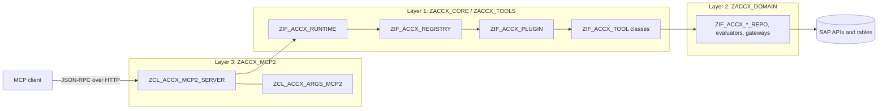
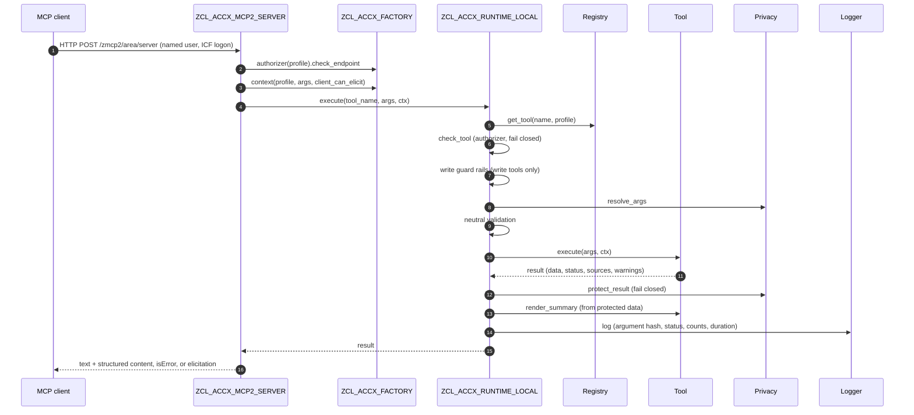

[Deutsch](../de/architecture.md) | **English**

# Access Explorer (ACCX) – Architecture

Access Explorer (ACCX) is an MCP server that runs inside an SAP ABAP system. It answers questions of SAP Basis support, authorization administrators and auditors about users, roles, authorizations, the Fiori launchpad, OData services and CDS access control. The current release is the constant `ZIF_ACCX_TYPES=>CO_RELEASE`.

This document describes how ACCX is built. Tool reference and installation steps are covered in the repository READMEs.

- Platform: SAP_BASIS / SAP_UI (tested on ABAP Platform 2023), embedded Fiori deployment
- Language version: Standard ABAP (classic). ABAP Cloud is **not** supported
- MCP transport: the [abap-ai/mcp2](https://github.com/abap-ai/mcp2) SDK, through a replaceable adapter

---

## 1. Three layers

| Layer | Packages | Content | Knows the MCP SDK? |
|---|---|---|---|
| 1 Tool catalog | `ZACCX_CORE`, `ZACCX_TOOLS` | Neutral contracts (descriptor, arguments, result), runtime pipeline, registry, one class per tool | no |
| 2 Domain services | `ZACCX_DOMAIN` | Readers and evaluators for users, roles, authorizations, SUIM, launchpad content, OData, CDS/DCL, change documents. All SAP APIs and table access are encapsulated here | no |
| 3 SDK adapter | `ZACCX_MCP2` | Maps descriptors to MCP tool definitions, requests to `ZIF_ACCX_ARGS` and results to MCP responses | **yes, as the only layer** |

### Why the SDK stays replaceable

- Tools never see an SDK object. They receive `ZIF_ACCX_ARGS` and `ZIF_ACCX_CONTEXT` and return the neutral structure `ZIF_ACCX_TYPES=>TY_RESULT`.
- A tool describes itself with a neutral descriptor (`TY_TOOL_DESCRIPTOR`: name, title, description, group, typed parameters, read-only/idempotent/destructive flags, sensitivity, plugin). The adapter builds the JSON schema and the MCP annotations from it.
- Parameter validation (required, enumerations, ranges, lengths) runs in the core runtime, not only in the SDK, so every transport gets the same checks.
- The adapter contains no `CASE` over tool names. A new tool is a new class registered by a plugin; the adapter is not changed.
- Adapters obtain everything through `ZCL_ACCX_FACTORY` and only call the interface `ZIF_ACCX_RUNTIME`.

A different transport (another ABAP MCP SDK, a REST/JSON handler, an RFC facade) is a new sibling adapter package with one server class and one `ZIF_ACCX_ARGS` implementation. Core, tools and plugins stay unchanged.

---

## 2. Packages and repositories

One abapGit repository is one installation unit. Whatever is installed, replaced or left out independently has its own root package and its own repository.

| Repository | Root package | Sub packages | Content | Depends on | Install |
|---|---|---|---|---|---|
| [abap-accx-base](https://github.com/MDJoerg/abap-accx-base) | `ZACCX` | `ZACCX_CORE`, `ZACCX_DOMAIN`, `ZACCX_TOOLS` | Product: contracts, runtime, registry, privacy, caller guard, domain services, read-only tools, configuration tables | SAP_BASIS, SAP_UI | always |
| [abap-accx-mcp2](https://github.com/MDJoerg/abap-accx-mcp2) | `ZACCX_MCP2` | – | MCP adapter for the mcp2 SDK | `ZACCX`, mcp2 SDK (`ZAGP_MCP2_*`) | when mcp2 is the transport |
| [abap-accx-mcp1](https://github.com/MDJoerg/abap-accx-mcp1) | `ZACCX_MCP1` | – | MCP adapter for the older mcp SDK (`ZAGP_MCP_*`), same features as mcp2 | `ZACCX`, mcp SDK | when mcp (v1) is the transport |
| [abap-accx-plugin-admin](https://github.com/MDJoerg/abap-accx-plugin-admin) | `ZACCX_PLG_ADMIN` | – | Plugin ADMIN: write tools for role maintenance and role assignment | `ZACCX` | optional |
| [abap-accx-gui](https://github.com/MDJoerg/abap-accx-gui) | `ZACCX_GUI` | – | Report to maintain the server profiles | `ZACCX` | optional |
| [abap-accx-test](https://github.com/MDJoerg/abap-accx-test) | `ZACCX_TEST` | – | Test data setup (test roles, SUIM test rules) | `ZACCX`, `ZACCX_PLG_ADMIN` | development / QA only |

**Installation order:** mcp2 SDK → `abap-accx-base` → `abap-accx-mcp2` (or `abap-accx-mcp1`) → plugins (`abap-accx-plugin-admin`) and `abap-accx-gui` → `abap-accx-test`.

Rules:

- The adapter, the plugins and the test package are **not** sub packages of `ZACCX`, although their names start with `ZACCX_`; otherwise abapGit would pull them into the product repository.
- All packages belong to a software component other than `ZLOCAL` (e.g. `HOME`), because `ZLOCAL` enforces ABAP Cloud on recent releases, where the mcp2 SDK cannot be used.
- Only `ZACCX_MCP2` uses the mcp2 SDK. Plugins use only the public core contracts, so they work with any adapter.
- abapGit has no dependency resolution; the dependencies are documented in each repository.

---

## 3. Core contracts

All contracts live in `ZACCX_CORE` and are free of SDK types.

| Contract | Implementation(s) | Role |
|---|---|---|
| `ZIF_ACCX_TYPES` | – | Neutral types and constants: result status (`ok`, `partial`, `not_found`, `ambiguous`, `denied`, `invalid`, `error`, `confirmation_required`), parameter kinds, tool groups (USER, ROLE, DIAG, FIORI, DATA, AUDIT, ADMIN), reserved parameters (`max_rows`, `cursor`, `language`, `system`, `plan_id`, `confirm`), tool descriptor, result, release |
| `ZIF_ACCX_TOOL` | `ZCL_ACCX_TOOL_BASE` (optional abstract base), `ZCL_ACCX_T_*` | One tool. Two phases: `execute` produces data, status, sources and warnings; `render_summary` writes the Markdown summary afterwards from the already protected data. `get_descriptor` describes it |
| `ZIF_ACCX_ARGS` | `ZCL_ACCX_ARGS_MAP` (in memory), `ZCL_ACCX_ARGS_MCP2` (adapter) | Adapter-neutral access to tool arguments (`has`, `get_string`, `get_integer`, `get_boolean`, `get_strings`, `get_names`) |
| `ZIF_ACCX_CONTEXT` | `ZCL_ACCX_CONTEXT` | Request context: caller, language, row limit, server profile, system id, caller guard, privacy strategy, authorizer, whether the client can elicit, and why write tools may not run (`write_problem`) |
| `ZIF_ACCX_REGISTRY` | `ZCL_ACCX_REGISTRY` | Discovers plugins, collects their tools, filters them by the tool groups of the profile, rejects duplicate names, reports plugin issues |
| `ZIF_ACCX_RUNTIME` | `ZCL_ACCX_RUNTIME_LOCAL` | Single entry point for adapters: `get_catalog` (visible tools) and `execute` (pipeline, see section 4); `get_prompts`, `get_prompt`, `get_resources` and `read_resource` for prompts and resources. Never raises; every failure is a result with a status |
| `ZIF_ACCX_PLUGIN` | `ZCL_ACCX_CORE_PLUGIN` (id CORE), `ZCL_ACCX_ADMIN_PLUGIN` (id ADMIN) | Plugin contract: `get_info` (id, title, version, required core API), `check_prerequisites`, `get_tools`, optional `get_prompts` and `get_resources` |
| `ZIF_ACCX_PROMPT` | `ZCL_ACCX_PROMPT_BASE` (base class), `ZCL_ACCX_P_*` | One prompt: descriptor with arguments and the tools it relies on, `render` (messages). Never raises; a bad argument is a result with status `invalid` |
| `ZIF_ACCX_RESOURCE` | `ZCL_ACCX_R_*` | One resource: descriptor (URI, MIME type) and `read`, which receives the tools available to the caller |
| `ZIF_ACCX_LOGGER` | `ZCL_ACCX_LOGGER_DB` | Audit log of every tool call into `ZACCX_LOG` |
| `ZIF_ACCX_PRIVACY` | `ZCL_ACCX_PRIVACY_NONE`, `ZCL_ACCX_PRIVACY_DEFAULT`, `ZCL_ACCX_PRIVACY_WITHHOLD` | Privacy strategy: `protect_result` (outgoing data), `resolve_args` (incoming pseudonyms) |
| `ZIF_ACCX_AUTHORIZER` | `ZCL_ACCX_AUTHORIZER` (allows), `ZCL_ACCX_AUTHORIZER_DENY` (denies) | Usage authorization extension point: `check_endpoint`, `check_tool` |
| `ZIF_ACCX_CALLER_GUARD` | `ZCL_ACCX_CALLER_GUARD` | Data-level display checks of the caller (users, user groups, roles, profiles, authorizations, change documents, privileged CDS data preview), cached per request |
| `ZIF_ACCX_PLAN_STORE` | `ZCL_ACCX_PLAN_STORE` | Plans of write tools in `ZACCX_PLAN`: `create`, `get`, `claim` (once), `close`, `cleanup` |
| – | `ZCL_ACCX_FACTORY` | Creates all core collaborators from the profile configuration; test seam (`inject`, `reset`) |
| – | `ZCX_ACCX_ERROR` | Exception carrying a result status and an LLM-readable message |

Domain services are obtained through `ZCL_ACCX_DOMAIN_FACTORY`, which has the same `inject`/`reset` test seam.

---

## 4. Request flow of `tools/call`

Pipeline of `ZCL_ACCX_RUNTIME_LOCAL->execute`:

1. Resolve the tool in the registry for the server profile; unknown tool: `invalid`.
2. Usage authorization `ZIF_ACCX_AUTHORIZER->check_tool`; an exception counts as not authorized: `denied`.
3. Write tools only (descriptor `read_only = false`): the profile must allow writing and the client must not be productive, else `denied`; `plan_id` and `confirm` only together, else `invalid`.
4. Resolve pseudonyms in the arguments (`resolve_args`).
5. Neutral validation of the parameters against the descriptor; `invalid` with a readable message.
6. Execute the tool. `ZCX_ACCX_ERROR` keeps its status; any other exception becomes `error`.
7. `protect_result`. If it fails, the data is withheld.
8. `render_summary` from the protected data, so personal data cannot leak through the text.
9. Write the audit log: arguments only as SHA-256 hash; for write tools the outcome (plan id and summary), also when ok. A logging failure never breaks the call.

`tools/list` uses `get_catalog`: the tools of the profile, minus write tools where writing is not allowed, minus tools the authorizer rejects.

The adapter maps the result: `ok`/`partial` become text (summary, warnings, next steps, sources) plus structured content; `denied`/`invalid`/`error` become a tool result with `isError`; `confirmation_required` becomes a form elicitation if the client supports it, otherwise the plan as text.

---

## 5. Plugins

The core runs on any plain ABAP stack. Solution-specific or risky functionality comes as a separate package with a class implementing `ZIF_ACCX_PLUGIN`.

- **Discovery:** the registry finds all classes implementing `ZIF_ACCX_PLUGIN`.
- **Activation is explicit:** the built-in CORE plugin (`ZCL_ACCX_CORE_PLUGIN`, all read-only tools) is always active. Every other plugin is inactive until it has an active row in `ZACCX_PLUGIN`, optionally restricted to listed profiles and with a priority.
- **Compatibility:** a plugin whose `required_core_api` differs from `ZIF_ACCX_PLUGIN=>CO_CORE_API_VERSION` is skipped. The core API version only increases with incompatible contract changes.
- **Isolation:** a plugin that raises an exception or fails `check_prerequisites` is skipped and reported via `ZIF_ACCX_REGISTRY->get_issues`; it never breaks the tool list.
- **Conflicts:** tool names are globally unique; CORE is loaded first, so on a duplicate name the core wins and the plugin tool is ignored.
- **Uninstall:** if the package is removed, the class is missing and the stale row in `ZACCX_PLUGIN` has no effect.

### Prompts and resources

Plugins contribute prompts and resources the same way as tools, through the optional methods `get_prompts` and `get_resources` of `ZIF_ACCX_PLUGIN`. The registry collects them (a duplicate prompt name or resource URI is rejected, the first wins) and the runtime offers a prompt only if every tool it relies on is available to the caller in that profile: tool groups of the profile, write permission and usage authorization apply to prompts through their tools. The adapter maps the neutral descriptors to the protocol (for mcp2: prompts/list, prompts/get, resources/list, resources/read); a transport without these features simply does not call the runtime methods.

The texts are fixed in classes and never contain data from the system, so nothing the system returns can turn into an instruction to the model. The only variable part of a prompt are its declared arguments, which `ZCL_ACCX_PROMPT_BASE` requires, trims and limits to one line of at most 100 characters. Prompts and resource reads read no data and are not written to the audit log.

### Plugin ADMIN and the write safeguards

`ZACCX_PLG_ADMIN` contributes the only write tools: `apply_role_change` (change or create a PFCG role, maintain composite roles, pass changes on to derived roles) and `assign_role` (assign a role, change the validity of a direct assignment, remove it). Running `ZCL_ACCX_ADMIN_PLUGIN` with F9 in ADT activates the plugin for profile `bc/access-admin` and creates that profile with write permission; it refuses to do so in a production client.

| Safeguard | Where | Effect |
|---|---|---|
| Write profile | Core runtime, `ZACCX_PROFILE-ALLOW_WRITE` | Write tools are listed and executed only in profiles that allow writing; elsewhere they are hidden and a call returns `denied` |
| Productive client | Core runtime, `T000-CCCATEGORY` | Never in a production client, regardless of the profile |
| Usage authorization | `ZIF_ACCX_AUTHORIZER` | Applies to write tools like to every tool (e.g. a customer check on tool group ADMIN) |
| Plan and confirmation | Tool, plan store, adapter | The first call only plans: it stores the plan in `ZACCX_PLAN` (valid 15 minutes) and returns `confirmation_required`. Only a second call with `plan_id` and `confirm = true` executes. The core rejects `plan_id` without `confirm` and vice versa |
| Execute once, by the creator | `ZIF_ACCX_PLAN_STORE->claim` | A plan is claimed with a single conditional update: only by its creator, only for the same tool, only before expiry, only once |
| Fingerprint | Tool | The plan stores a fingerprint of the target state (menu, authorization data, profile, single and derived roles; for assignments the user's assignments and profiles). If the target changed between plan and execution, the execution is refused and the plan cancelled |
| Critical access checks | Tool, `ZIF_ACCX_CRITICAL_RULES` | Before a plan is stored, the critical authorizations and critical combinations maintained in SUIM are evaluated. Any gain is refused unless the caller passes `accept_critical` |
| Further refusals | Tool | Own role assignments, SAP template roles (copy instead), derived roles (change the reference role), missing change authorization (`S_USER_AGR`, `S_USER_GRP`) |
| MCP confirmation | Adapter | Write tools carry `destructiveHint`. Clients that support form elicitation are asked directly; declining cancels the plan. Other clients receive the plan as text, and the server instructions require explicit user approval |
| Audit | Logger, SAP change documents | Every write call is logged with its outcome; SAP writes its own change documents |

---

## 6. Security model

- **Named users only.** The caller is the principal (`sy-uname`). There is no technical super user as MCP caller; results reflect the caller's own authorizations, as in SUIM.
- **Endpoint:** ICF logon and `S_ICF` on the service node, then `ZIF_ACCX_AUTHORIZER->check_endpoint`.
- **Tool level:** `ZIF_ACCX_AUTHORIZER->check_tool` with the full descriptor (group, sensitivity, plugin). It filters the catalog and is checked again before every execution.
- **Data level – caller guard:** most SAP read APIs and tables do not check the caller. Tools therefore filter every row through `ZIF_ACCX_CALLER_GUARD`:
  - users and user groups: `S_USER_GRP` activity 03 (change documents: 08)
  - roles: `S_USER_AGR` activity 03 (change documents: 08)
  - profiles: `S_USER_PRO` 03; authorizations: `S_USER_AUT` 03
  - row counts of CDS entities without access control (`simulate_cds_access`): the ADT data preview check with DCL override (`S_DEVELOP`)
  - Rows the caller may not display are removed and counted (`hidden_by_authorization`), never silently dropped. The SUIM APIs and the SU53 reader check the caller themselves.
- **No own authorization object.** ACCX deliberately ships none. Usage authorization is decided in the customer project:
  1. Create an authorization object in the customer namespace (e.g. with fields for profile, tool group and activity).
  2. Subclass `ZCL_ACCX_AUTHORIZER` and redefine `check_endpoint` and/or `check_tool` with an `AUTHORITY-CHECK` on that object.
  3. Enter the class in `ZACCX_PROFILE-AUTHORIZER_CLASS`.
  Without configuration, `ZCL_ACCX_AUTHORIZER` allows usage. If the configured class cannot be instantiated, `ZCL_ACCX_AUTHORIZER_DENY` denies everything; if the customer method raises an exception, the tool counts as not authorized.
- **Fail closed** in usage authorization, privacy and write guard rails.
- **Side effect:** simulated checks (`AUTHORITY-CHECK ... FOR USER`) that fail are written to the SU53 buffer of the calling user. The tools warn about it and the failure reader filters such entries.

---

## 7. Privacy layer

Privacy is applied centrally in the runtime, not in each tool.

- `ZIF_ACCX_PRIVACY->protect_result` runs after `execute` and **before** `render_summary`, so the Markdown summary is built from protected data only.
- `ZIF_ACCX_PRIVACY->resolve_args` runs before validation; it maps pseudonyms back to clear values so that tools only see clear values. An unknown pseudonym raises `ZCX_ACCX_ERROR` (status `invalid`). The message of a failed tool call is passed through `protect_result` as well.
- Configuration per profile in `ZACCX_PROFILE`: `PRIVACY_MODE` (`NONE`, `PSEUDONYMIZE`, `MINIMIZE`) or a customer class in `PRIVACY_CLASS` implementing `ZIF_ACCX_PRIVACY`.
- `NONE` (`ZCL_ACCX_PRIVACY_NONE`) passes everything. `PSEUDONYMIZE` and `MINIMIZE` are implemented by `ZCL_ACCX_PRIVACY_DEFAULT`, which a customer class can derive from (redefine `TRANSFORM_USER_ID`, `TRANSFORM_NAME`, `TRANSFORM_CONTACT`, `TRANSFORM_TIMESTAMP`). An unknown mode, an unusable class or an exception in `protect_result` leads to `ZCL_ACCX_PRIVACY_WITHHOLD` or an equivalent error result: data, structured data and summary are withheld with a warning.
- **Which fields are personal.** `ZCL_ACCX_PRIVACY_DEFAULT` walks the result data by RTTI. A field is personal if its data element (rule kind `D`) or its component name (kind `C`, either `NAME` or `PARENT-NAME`) has a rule with one of the categories `USER_ID`, `USER_LIST`, `NAME`, `CONTACT`, `TIMESTAMP`. The built-in rules can be extended or switched off in table `ZACCX_PII` (an empty category switches a rule off). Tools therefore contain no privacy code; a new tool is covered if its result fields use such data elements or names. A unit test (`LTC_AUDIT`) checks the result type of every registered tool and fails for personal-looking fields without a rule.
- **Texts.** User ids, names and rounded logon times found in fields are also replaced in every other string of the result, in next steps and warnings, at word boundaries.
- **Pseudonyms.** `ZIF_ACCX_PSEUDONYMS` / `ZCL_ACCX_PSEUDONYMS`: `U-` plus the first eight hex characters of HMAC-SHA256 over client and user id. The random key is stored per client in table `ZACCX_SECRET` and created on first use; redefine `GET_KEY` to keep it elsewhere. No mapping is stored: the reverse lookup compares the pseudonym with those of all users of the client. People reveal pseudonyms with report `ZACCX_PSEUDONYM_RESOLVE`; there is no tool for it.
- **Fail closed.** Sorted or hashed tables in a result, serialized result data and fields too short for their pseudonym withhold the result.
- The audit log never stores argument values, only a SHA-256 hash of them.

---

## 8. Configuration and housekeeping

| Table | Delivery class | Purpose |
|---|---|---|
| `ZACCX_PROFILE` | C | One row per server profile (`<area>/<server>`, e.g. `bc/access-support`): `TOOL_GROUPS` (comma list or `*`), `PRIVACY_MODE`, `PRIVACY_CLASS`, `AUTHORIZER_CLASS`, `MAX_ROWS`, `ALLOW_WRITE`. A profile without a row exposes all tools of the active plugins with default settings and without write tools |
| `ZACCX_PLUGIN` | A | Plugin activation: `PLUGIN_ID`, `CLASS_NAME`, `ACTIVE`, `PRIORITY`, `PROFILES`, activated by/at |
| `ZACCX_LOG` | A | Audit log: time, caller, profile, system id, tool, status, row and hidden counts, duration, argument hash, message |
| `ZACCX_PLAN` | A | Plans of write tools: id, tool, caller, profile, target, state, created/expires/closed, fingerprint, payload (JSON), plan text, outcome |

Row limit: default 50, maximum 500; per profile `MAX_ROWS`, per call the reserved parameter `max_rows`.

The server profile is the `<area>/<server>` part of the mcp2 endpoint. Running `ZCL_ACCX_MCP2_SERVER` with F9 registers the default profile and every profile of `ZACCX_PROFILE` as mcp2 endpoints and lists the visible tools per profile and any plugin issues. Several profiles point to the same adapter class.

Critical authorizations, combinations and their variants are maintained in SUIM, not in ACCX.

### Cleanup program `ZACCX_PLAN_CLEANUP`

To be scheduled by the administrator as a periodic background job (e.g. daily). It calls `ZIF_ACCX_PLAN_STORE->cleanup`:

- expired `OPEN` plans become `CANCELLED`;
- plans still `RUNNING` a given number of minutes after expiry (default 60) – an execution aborted by a runtime error – become `FAILED` with the note that the change may be incomplete;
- closed plans are deleted after a retention period (default 90 days, 0 = keep).

Every row is changed only in the state it was read in, so the cleanup cannot interfere with a concurrent claim. A test run changes nothing. Results go to the list and the job log. `ZACCX_LOG` is not touched.

Plan states: `OPEN`, `RUNNING`, `EXECUTED`, `PARTIAL`, `FAILED`, `CANCELLED`.

---

## 9. Testing

- **ABAP Unit** in every tool class and in the central core and domain classes, all `RISK LEVEL HARMLESS`, `DURATION SHORT`.
- **Test doubles** replace collaborators through the test seams `ZCL_ACCX_FACTORY=>inject` (registry, runtime, privacy, authorizer, caller guard, plan store) and `ZCL_ACCX_DOMAIN_FACTORY=>inject` (domain services); `reset` restores the defaults. Arguments are built with `ZCL_ACCX_ARGS_MAP`; no MCP SDK is needed.
- **Runtime tests** (`ZCL_ACCX_RUNTIME_LOCAL`) cover validation, error mapping, row limit, privacy before summary, privacy failure, logging, authorizer deny/filter/crash and the write guard rails (hidden without permission, plan then confirmation, `plan_id`/`confirm` combinations, write calls logged).
- **Database access** of the plan store is tested with the ABAP SQL test double framework (`CL_OSQL_TEST_ENVIRONMENT`).
- **Integration tests** of the CORE plugin run against the real system.
- **End-to-end** over HTTP with an administrator and with a restricted support user, to verify the caller guard.
- **Test data package `ZACCX_TEST`** (development and QA only, never in production): `ZCL_ACCX_TEST_SETUP` holds the desired state of the test roles `ZACCX_T_*` and of SUIM test rules (critical authorization, critical combination, variants). By default it only reports deviations; applying is an explicit switch and is refused in production clients. It uses the declarative role writer `ZIF_ACCX_ROLE_WRITER` of `ZACCX_PLG_ADMIN`. `ZCL_ACCX_TEST_WRITE_ROLE` resets the target roles of the write tool tests. Test users are created manually.

---

## 10. SAP sources per domain service

Stability classes:

- **A** – released or stable API (BAPI, RFC-enabled SUIM API, kernel statement)
- **B** – stable but unreleased DDIC tables or unreleased classes, read only
- **C** – internal logic or workaround, encapsulated in exactly one class so that a release change affects one place

| Domain service | Responsibility | SAP sources | Class |
|---|---|---|---|
| `ZIF_ACCX_USER_REPO` | User master, user groups, role and profile assignments, profile parameters | `USR02`, `USR21`/`ADRP`, `USR11`, `AGR_USERS`, `UST04`, `AGR_1016` | B |
| `ZIF_ACCX_ROLE_REPO` | Role header, type, derivation, composite roles, menu, authorizations with PFCG status, organizational levels, profile state, holders | `AGR_DEFINE`, `AGR_1250`, `AGR_1251`, `AGR_1252`, `AGR_1016`, `AGR_AGRS`, `AGR_FLAGS`, `AGR_TEXTS`, `AGR_TCODES`, `AGR_USERS`, `USORG` | B |
| `ZIF_ACCX_AUTH_EVALUATOR` | Required checks of a transaction, simulation for another user | `AUTHORITY-CHECK ... FOR USER` (A); `TSTC`, `TSTCA`, `TOBJ` (B) | A / B |
| `ZIF_ACCX_ACCESS_ORIGIN` | Origin of authorizations in the user master (role, composite role, profile, reference user) | `UST04`, `USREFUS`, `UST10C`, `UST10S`, `UST12`, `AGR_1016`, `AGR_AGRS` | B |
| `ZIF_ACCX_SUIM_GATEWAY` | Users and roles by criteria, critical access per SUIM variant; always `DESTINATION 'NONE'` (own session, protected against `LEAVE PROGRAM` and report state) | `SUSR_SUIM_API_RSUSR002`, `SUSR_SUIM_API_RSUSR070`, `SUSR_SUIM_API_RSUSR008_009_NEW`, `SUSR_API_RSUSR008_009_NEW_ROLE` (check the caller); `USRVAR*` | A (internally report based) |
| `ZIF_ACCX_CRITICAL_RULES` | Critical authorizations and combinations with SUIM semantics | `USCRAUTHID`, `USCRAUTH`, `USCRAUIDT`, `USRCOMB`, `USCRCOMID` | B |
| `ZIF_ACCX_FAILURE_SOURCE` | Failed checks of a user (SU53 of all application servers, user trace), trace status | `SUSR_USER_SU53_READ` (checks the caller), `SUAUTH_READ_USER_TRACE`, `CL_SUSR_TOOLS_KERNEL`, `SUAUTHVALFILTER` | B |
| `ZIF_ACCX_PROPOSAL_SOURCE` | SU24 proposals of transactions and service hashes | `USOBX_C`, `USOBT_C` | B |
| `ZIF_ACCX_FIORI_REPO` | Catalogs, tiles, target mappings, groups, spaces, pages, launchpad settings, authorization defaults of catalogs, OData services, ICF | FDM public catalog and group API (package interface `/UI2/FDM_PUBLIC_API_EXT`) (A); FDM space and page API, `/UI2/CL_FLP_SETTINGS_API`, UI5 app index, `AGR_HIER`/`AGR_BUFFI`, `/IWFND/I_MED_SRH`, `/IWFND/C_MGDEAM`, `ICFSERVICE`, `USOBHASH` (B); `/UI2/CL_CATALOG_DETAIL` (PFCG catalog details) (B/C) | A / B / C |
| `ZIF_ACCX_CDS_ACCESS` | CDS entities, access control annotation, DCL roles, exposing service definitions and bindings | `DDLDEPENDENCY`, `DD02B`, `DDHEADANNO`, `DDDDLSRCT`, `TADIR`, `ACMDCLMETADATA`, `ACMDCLSRC`, `SRVD_RT_ENTITIES`, `SRVB_SERVICES`, `/IWFND/I_MED_SRH`, `/IWFND/C_V4_MSGR` (B); DCL source analysed as text (`ZCL_ACCX_DCL_ANALYZER`) (C); access restrictions for a user from the ACM runtime `CL_ACMRT_KERNEL_PROXY` (`IF_ACMRT_RUNTIME~GET_ACCESS_RESTRICTIONS`, as SACMSEL) (B); row counts with `SELECT COUNT(*) ... WITH PRIVILEGED ACCESS` (A) | B / C |
| `ZIF_ACCX_CHANGE_REPO` | Change documents of roles and users | `CDHDR`, `CDPOS` (objects PFCG, IDENTITY), `USH02` | B |
| `ZIF_ACCX_ROLE_CHANGER` (plugin ADMIN) | Incremental role change, composite roles, derived roles, generation | `CL_PFCG_MENU_MODIFY`, `PRGN_AUTO_GENERATE_PROFILE_NEW`, `PRGN_RFC_*`, `PRGN_COPY_AGR`, `SUPRN_TRANSFER_AUTH_DATA` (B); values for open fields written to `AGR_1251` with change documents (C) | B / C |
| `ZIF_ACCX_ASSIGNMENT_WRITER` (plugin ADMIN) | Direct role assignments of a user | `BAPI_USER_GET_DETAIL`, `BAPI_USER_ACTGROUPS_ASSIGN` (check the caller, write change documents) | A |

Domain services read **without** authorization checks unless the SAP API checks itself; the tools filter with the caller guard. The domain implementation classes are not final, so customer projects can subclass them (for example to read critical rules from another rule set).

---

## 11. Multi-system outlook (not implemented)

The default is one ACCX instance per system; an MCP client connects to several servers. A central server federating several systems is **not implemented**. The design keeps it possible without changing the adapter: adapters only know `ZIF_ACCX_RUNTIME`, the result and descriptor carry reserved JSON fields (`data_json`, `output_schema_json`), the parameter name `system` is reserved, and `ZACCX_LOG` has a system id column.
