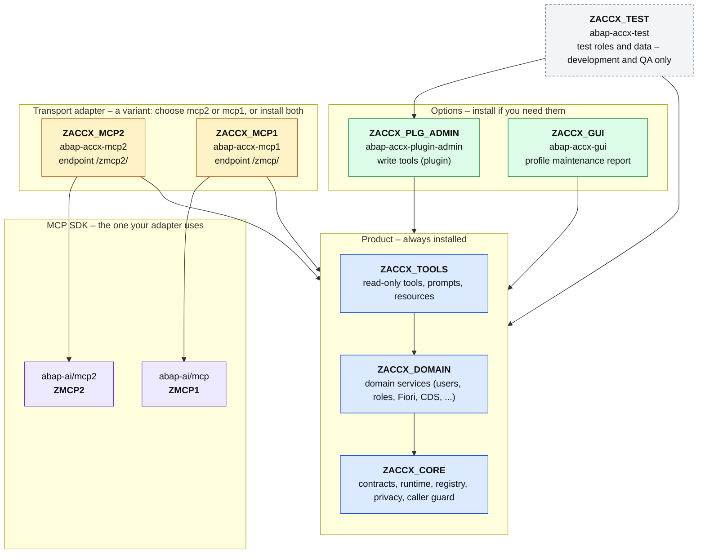
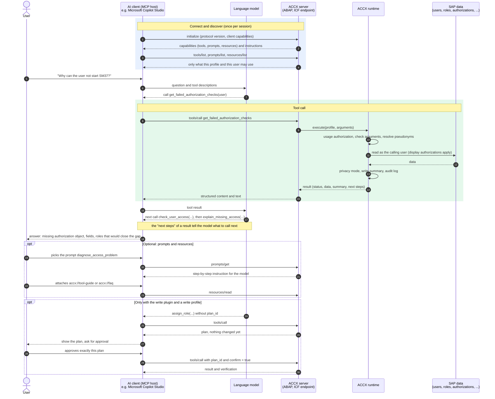
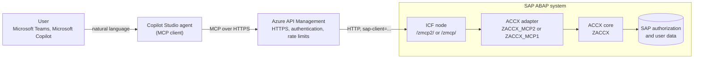

# Access Explorer (ACCX) – Overview: packages and MCP flow

*[Deutsch](../de/overview.md)*

This page shows two things: how the ABAP packages of ACCX fit together (and which of them
are options or variants), and what happens on the wire when an AI client talks to ACCX.
Details of each layer are in the [architecture](architecture.md), the tools in the
[user guide](user-guide.md).

## 1. Package structure

Every box is an ABAP package and an abapGit repository of its own. An arrow means "depends on".

| Colour | Meaning | Packages |
|---|---|---|
| Blue | Product, always installed. The core does not know any MCP SDK | `ZACCX` with `ZACCX_CORE`, `ZACCX_DOMAIN`, `ZACCX_TOOLS` |
| Yellow | **Variant**: the transport adapter for your MCP SDK. You need one; both can run side by side | `ZACCX_MCP2`, `ZACCX_MCP1` |
| Green | **Option**: install only if you need the function | `ZACCX_PLG_ADMIN` (writing), `ZACCX_GUI` (profile maintenance) |
| Grey, dashed | Development and QA only | `ZACCX_TEST` |
| Purple | External SDK, not part of ACCX | `ZMCP2`, `ZMCP1` |

Why the adapters are variants: both SDKs speak MCP, but they have different classes, ICF
nodes and registration tables. The tools never see them, so the same tools, prompts and
resources are served by either adapter. Installation order: SDK, `ZACCX`, adapter, then the
options.

## 2. How an AI client talks to ACCX

ACCX is an MCP server inside the ABAP system. The client (an "MCP host" such as Claude,
Microsoft Copilot Studio or your own agent) first asks what the server offers, and then
lets the model call the tools. Every call runs in the ABAP system **as the authenticated
user**.

What the diagram shows:

- **Discovery first.** The client learns the tool catalog, the prompts and the resources from
  the server. The catalog is already filtered: tool groups of the profile, write permission
  and usage authorization decide what is listed.
- **The model decides, ACCX executes.** The language model only sees tool descriptions and
  results. Execution, authorization checks, privacy and logging happen in ABAP.
- **Results guide the next call.** Each result carries "next steps" with the arguments of the
  sensible follow-up call, so a short chain of calls answers most questions.
- **Prompts and resources are optional.** Prompts are instructions a user picks; resources
  are background texts. Neither reads data from the system.
- **Writing is a two-step dialog.** A write tool returns a plan first. It is executed only
  with the plan id and a confirmation, after the user approved exactly that plan.

## 3. Example: Microsoft Copilot Studio

Microsoft Copilot Studio can use an MCP server as a tool source, so an agent in Microsoft
Teams or Microsoft Copilot can ask ACCX. In practice an API gateway such as Azure API
Management sits between the agent and the SAP system.

A tested walk-through of this setup (Copilot Studio agent, Azure API Management and an ABAP
MCP server built on the same abap-ai SDKs) is in
[hobru/mcp-with-copilot-studio](https://github.com/hobru/mcp-with-copilot-studio). For ACCX
the endpoint is `https://<host>/zmcp2/bc/access-support?sap-client=<client>` (or `/zmcp/...`
for the mcp1 adapter).

**One thing to decide before you connect an agent:** ACCX shows what the *calling SAP user*
may display, the way SUIM does. If the gateway injects one shared technical user, every
question runs with that user's authorizations. Prefer a named user per person (for example
through single sign-on), or a dedicated analysis user that has exactly the display
authorizations the agent should have, and consider a profile with privacy mode
`PSEUDONYMIZE` or `MINIMIZE` for agents that run in a cloud service.
